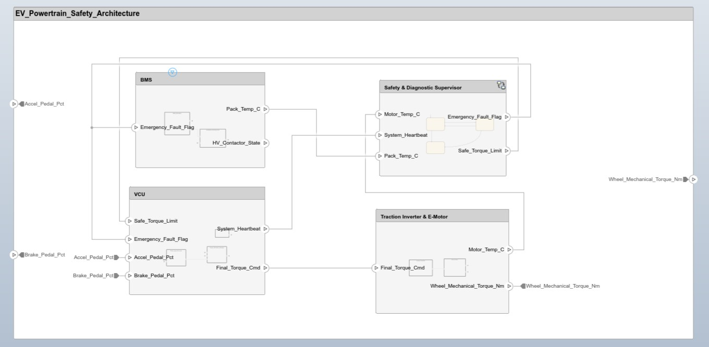
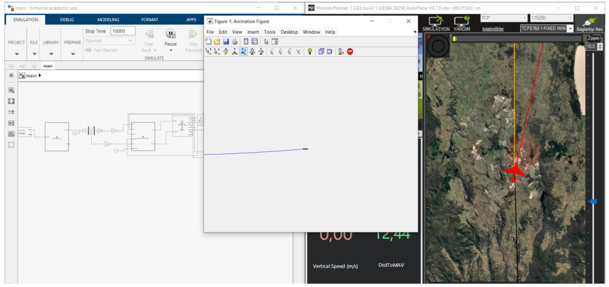

# MATLAB / Simulink Engineering Portfolio

A collection of small projects in **model-based design**, **systems engineering** and **autopilot simulation** using MATLAB, Simulink, System Composer and Python. Each project is in its own folder with a detailed README.

| Project | Summary | Tools |
|---|---|---|
| [**EV Powertrain Safety Architecture**](systemComposer_PowerRail/) | MBSE architecture of a battery-electric powertrain (VCU, BMS, inverter/motor, safety supervisor) with typed interfaces, a custom ISO 26262 / ASIL stereotype profile and a Stateflow safety state machine. | System Composer, Simulink, Stateflow |
| [**Torpedo SITL — Simulink ↔ ArduPilot Bridge**](torpedoSitl/) | Software-in-the-loop setup that connects a Simulink 6-DOF vehicle model to ArduPilot through its JSON physics backend. A Python UDP bridge learns ArduPilot's ephemeral port and routes PWM and state packets in both directions. | Simulink, Aerospace Blockset, Python (sockets), ArduPilot, Mission Planner |

## Previews

<table>
<tr>
<td width="50%"> EV Powertrain Safety Architecture</td>
<td width="50%"> Torpedo SITL with Mission Planner</td>
</tr>
</table>

## Skills covered

- **Model-based systems engineering:** hierarchical architectures, interface dictionaries, profiles and stereotypes
- **Functional safety concepts:** ASIL allocation, safe states, watchdog / heartbeat monitoring, hysteresis-based derating
- **Simulation:** 6-DOF rigid-body dynamics, Stateflow, MATLAB Function blocks
- **Software-in-the-loop integration:** ArduPilot SITL, UDP networking and I/O multiplexing in Python, MAVLink ground-station workflow
