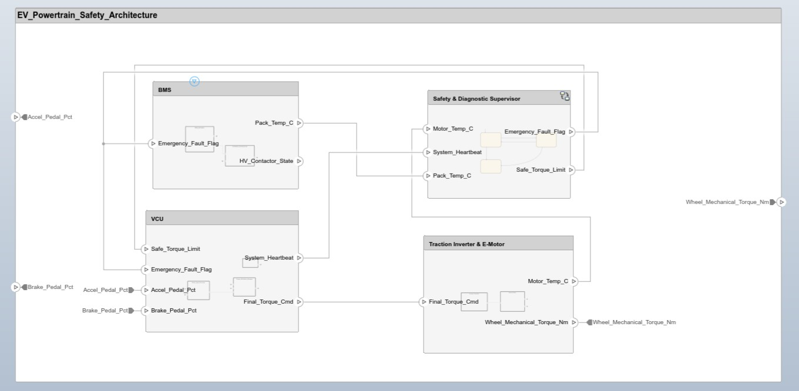
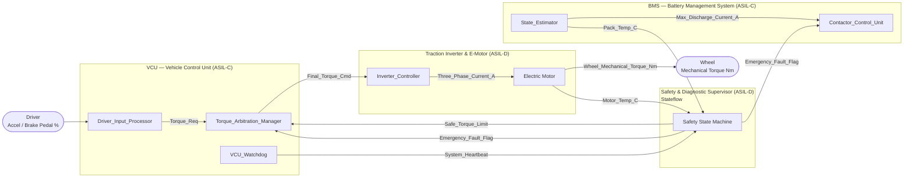
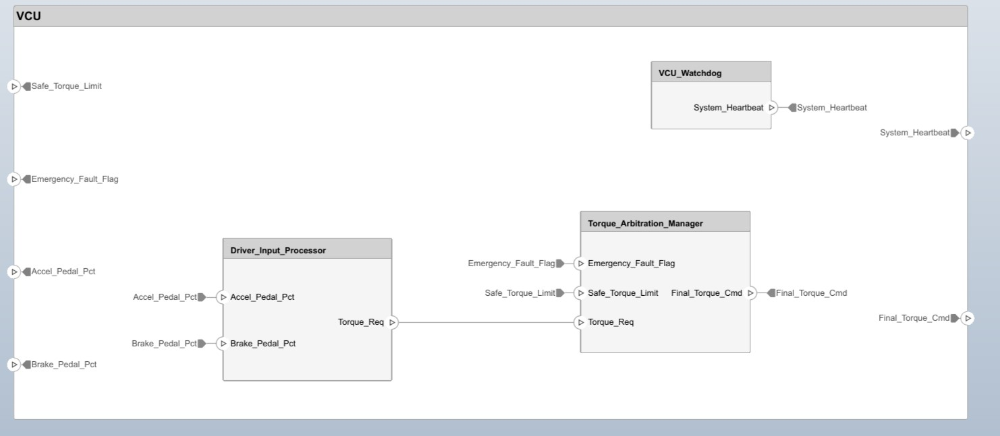
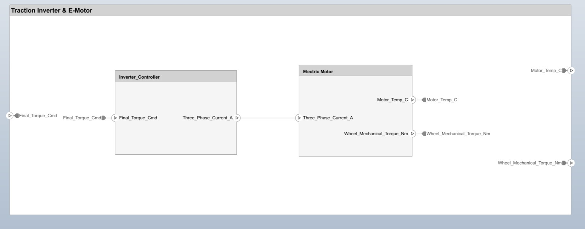
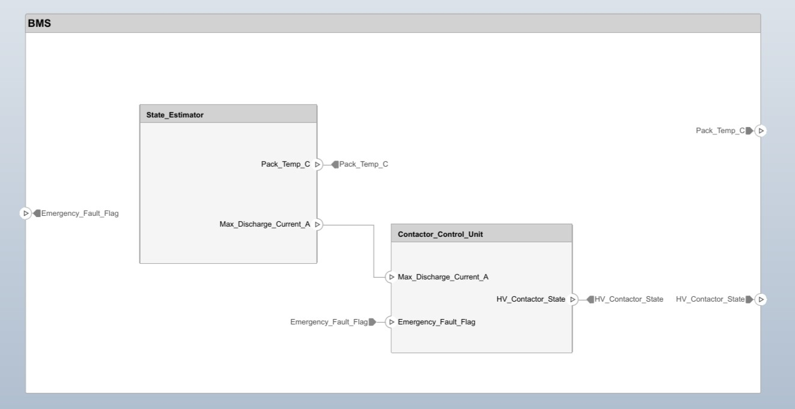
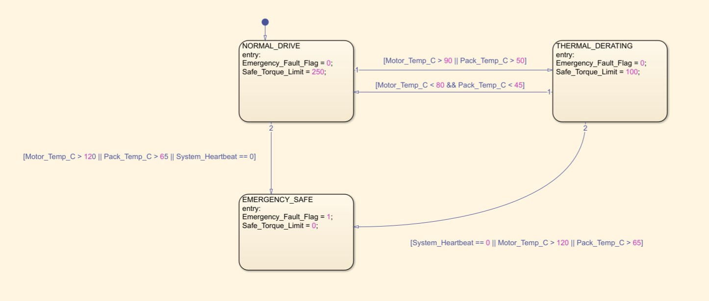
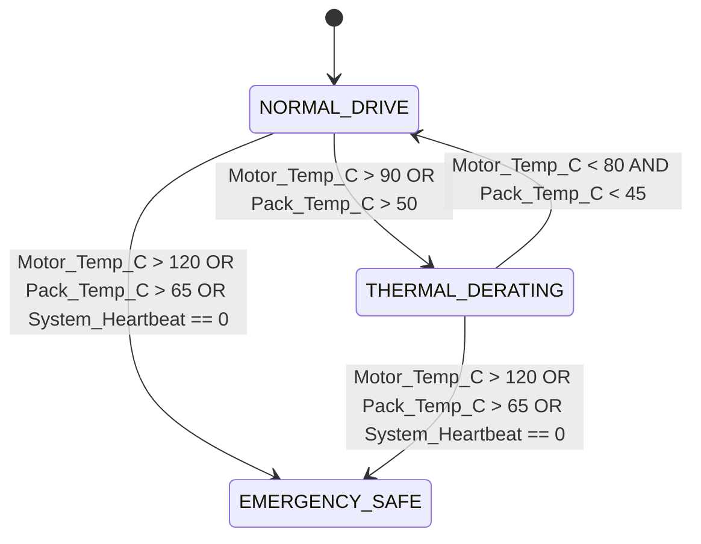

# EV Powertrain Safety Architecture — MATLAB System Composer

A model-based systems engineering (MBSE) architecture of a **battery-electric vehicle (BEV) powertrain**, built in **MATLAB System Composer** with a custom automotive safety profile and a **Stateflow**-based safety supervisor.

The project walks through the full System Composer workflow on an automotive use case:
- the powertrain split into ECUs and sub-functions
- typed interfaces with physical units
- a custom stereotype profile that carries ISO 26262-style metadata
- executable behavior attached to a safety-relevant component

> **Scope:** This is a compact portfolio model. It focuses on architecture and safety concepts, not on detailed plant physics or production-grade control algorithms.



---

## Highlights

| Topic | What is in the model |
|---|---|
| **Hierarchical architecture** | 4 top-level ECU/subsystem components, 7 sub-components, 2 levels of decomposition |
| **Interface management** | Interface Dictionary with unit-annotated data interfaces (`Nm`, `A`, `V`, `degC`, `%`) and a `CAN_Bus` composite interface |
| **Custom profile & stereotypes** | `Automotive_Safety_Profile` with an `ECU_Component` stereotype (`ASIL_Level`, `Max_Power_W`, `CAN_Cycle_ms`) |
| **Functional safety concepts** | ASIL tag on each ECU, watchdog heartbeat, emergency fault flag, HV contactor control, torque limiting and derating |
| **Executable behavior** | Stateflow chart in the Safety & Diagnostic Supervisor (Normal → Thermal Derating → Emergency Safe State) |

---

## System Architecture



### Component Overview

| Component | ASIL | Sub-components | Responsibility |
|---|---|---|---|
| **VCU** | C | `Driver_Input_Processor`, `Torque_Arbitration_Manager`, `VCU_Watchdog` | Reads accelerator/brake pedal position, computes the driver torque request, checks it against the safe torque limit and fault state, and sends a heartbeat signal |
| **Traction Inverter & E-Motor** | D | `Inverter_Controller`, `Electric Motor` | Turns the final torque command into phase current, delivers mechanical torque to the wheel and reports motor temperature |
| **BMS** | C | `State_Estimator`, `Contactor_Control_Unit` | Estimates pack state (temperature, max. discharge current) and opens/closes the HV contactors based on the emergency fault flag |
| **Safety & Diagnostic Supervisor** | D | Stateflow chart | Monitors temperatures and the VCU heartbeat, sets the safe torque limit and raises the emergency fault flag |

### Signal Flow (main torque path)

`Accel/Brake Pedal %` → **Driver_Input_Processor** → `Torque_Req` → **Torque_Arbitration_Manager** (capped by `Safe_Torque_Limit`, overridden by `Emergency_Fault_Flag`) → `Final_Torque_Cmd` → **Inverter_Controller** → `Three_Phase_Current_A` → **Electric Motor** → `Wheel_Mechanical_Torque_Nm`

---

## Subsystem Decomposition

### VCU — Vehicle Control Unit
The pedal inputs are processed into a torque request. The **Torque_Arbitration_Manager** combines this request with the safety supervisor's `Safe_Torque_Limit` and `Emergency_Fault_Flag` to produce the final torque command. The **VCU_Watchdog** sends the `System_Heartbeat` that the supervisor uses to detect a lost or frozen VCU.



### Traction Inverter & E-Motor
The **Inverter_Controller** turns `Final_Torque_Cmd` into three-phase current for the **Electric Motor**. The motor outputs the wheel torque and its temperature, which is sent back to the safety supervisor.



### BMS — Battery Management System
The **State_Estimator** provides the pack temperature and the maximum allowed discharge current. The **Contactor_Control_Unit** uses the discharge limit and the `Emergency_Fault_Flag` to decide the `HV_Contactor_State`, which disconnects the high-voltage battery in an emergency.



---

## Safety Supervisor — Stateflow Behavior

The **Safety & Diagnostic Supervisor** is the component with executable behavior. Its state machine reacts to motor temperature, pack temperature and the VCU heartbeat.





| State | `Safe_Torque_Limit` | `Emergency_Fault_Flag` | Meaning |
|---|---|---|---|
| `NORMAL_DRIVE` | 250 Nm | 0 | Full performance |
| `THERMAL_DERATING` | 100 Nm | 0 | Reduced torque to protect motor/battery from overheating |
| `EMERGENCY_SAFE` | 0 Nm | 1 | Safe state: zero torque, BMS opens HV contactors |

**Design notes**

- **Hysteresis** between derating entry (90 °C / 50 °C) and exit (80 °C / 45 °C) stops the system from switching back and forth between states.
- **The safe state can be reached from every operating state.** Critical temperature or a lost heartbeat triggers `EMERGENCY_SAFE` from both `NORMAL_DRIVE` and `THERMAL_DERATING`.
- **`EMERGENCY_SAFE` is latching.** There is no automatic recovery, which matches typical automotive safe-state behavior (recovery only after a reset or a new drive cycle).
- **Heartbeat monitoring** (`System_Heartbeat == 0`) detects a lost or frozen VCU and forces the safe state.

---

## Interfaces

Interfaces are defined in one place and assigned to ports, so every connection has a type and a physical unit:

| Interface | Unit | Used for |
|---|---|---|
| `Pedal_Pct` | `%` | Accelerator and brake pedal position |
| `Torque` | `Nm` | Torque request / torque command |
| `Three_Phase_Voltage_V` | `V` | Inverter phase voltage |
| `Current_A` | `A` | Phase current, discharge current limit |
| `Temp_degC` | `degC` | Motor and battery pack temperature |
| `Flag_Bool` | – | Fault / status flags |
| `CAN_Bus` | – | Composite interface for communication between ECUs (heartbeat, fault flag, torque limit, temperatures) |

---

## Custom Profile — `Automotive_Safety_Profile`

The profile ([`Automotive_Safety_Profile.xml`](Automotive_Safety_Profile.xml)) defines the stereotype **`ECU_Component`**. It is applied to the top-level ECUs so that engineering metadata is stored directly in the architecture:

| Property | Type | Default | Range | Purpose |
|---|---|---|---|---|
| `ASIL_Level` | string | `"ASIL-B"` | – | ISO 26262 Automotive Safety Integrity Level of the ECU |
| `Max_Power_W` | double | `15` | 0 – 100 | ECU power budget |
| `CAN_Cycle_ms` | int | `10` | 1 – 1000 | CAN message cycle time |

| Component | `ASIL_Level` |
|---|---|
| Safety & Diagnostic Supervisor | ASIL-D |
| Traction Inverter & E-Motor | ASIL-D |
| VCU | ASIL-C |
| BMS | ASIL-C |

Because the properties are stored in the model, they can be used for **Spotlight / custom views**, **analysis functions** (e.g. total ECU power budget, ASIL decomposition checks) and **report generation**.

---

## Repository Structure

```
.
├── EV_Powertrain_Safety_Architecture.slx   # System Composer architecture model (+ Stateflow chart)
├── Automotive_Safety_Profile.xml           # Custom stereotype profile (ECU_Component)
├── images/                                 # Screenshots of the architecture and the state machine
│   ├── main_system.jpg
│   ├── vcu_subsystem.jpg
│   ├── motor_subsystem.jpg
│   ├── bms_subsystem.jpg
│   └── safety_subsystem_flow.jpg
└── README.md
```

## How to Open

**Requirements:** MATLAB **R2026b** with System Composer, Simulink and Stateflow.

1. Clone the repository and open the folder in MATLAB.
2. Open the model:
   ```matlab
   systemcomposer.openModel('EV_Powertrain_Safety_Architecture');
   ```
3. The profile `Automotive_Safety_Profile.xml` is loaded automatically from the same folder. Select a component and open the **Property Inspector** to see its stereotype values.
4. Double-click **Safety & Diagnostic Supervisor** to open the Stateflow chart.

---

## Possible Extensions

- Link components to **requirements** with Requirements Toolbox (e.g. safety goals → technical safety requirements)
- Add an **analysis function** that adds up the ECU power budget and checks ASIL consistency
- Add **architecture views** (e.g. "Safety-relevant components", "CAN network view")
- Replace component stubs with **Simulink behavior models** (motor/inverter plant, battery thermal model) and run a closed-loop drive-cycle simulation
- Allocate the logical architecture to a physical ECU / CAN network architecture

---

## Tools & Concepts

`MATLAB System Composer` · `Simulink` · `Stateflow` · `MBSE` · `Interface Dictionary` · `Profiles & Stereotypes` · `ISO 26262 / ASIL` · `BEV Powertrain` · `VCU` · `BMS` · `Traction Inverter` · `CAN`
