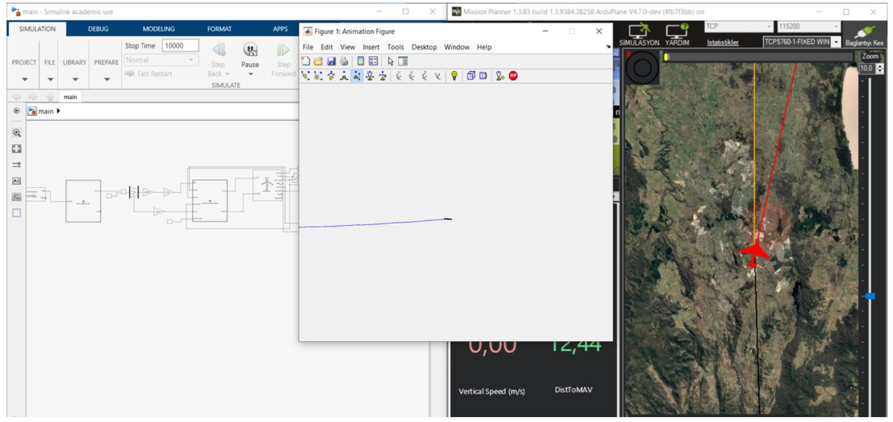

# Torpedo SITL — Simulink ↔ ArduPilot Bridge

A small **Software-in-the-Loop (SITL)** setup that connects a **MATLAB/Simulink 6-DOF vehicle model** to the **ArduPilot (ArduPlane)** autopilot through ArduPilot's JSON physics-backend interface. ArduPilot computes control outputs (PWM), Simulink simulates the vehicle dynamics, and the resulting state is fed back to the autopilot — closing the control loop entirely in software. The vehicle can be monitored and commanded from **Mission Planner** like a real aircraft.



*Left: Simulink model and the 6-DOF animation. Right: Mission Planner connected to ArduPlane SITL, following the simulated vehicle.*

---

## How it works

```
┌──────────────────┐   binary PWM (UDP)    ┌────────────────┐   PWM (UDP :9004)   ┌──────────────────────┐
│  ArduPilot SITL  │ ────────────────────▶ │                │ ──────────────────▶ │                      │
│   (ArduPlane)    │        → :9002        │  fakesim.py    │                     │  Simulink model      │
│                  │                       │  (UDP bridge)  │                     │  6-DOF dynamics      │
│                  │ ◀──────────────────── │                │ ◀────────────────── │  + JSON encoder      │
└──────────────────┘   JSON state (UDP)    └────────────────┘   JSON (UDP :9003)  └──────────────────────┘
        ▲            → ArduPilot's ephemeral port
        │ MAVLink (TCP 5760)
┌──────────────────┐
│  Mission Planner │
└──────────────────┘
```

### The problem the bridge solves

ArduPilot's JSON backend sends servo outputs **from a random (ephemeral) source port** and expects the physics engine to reply **to that exact address**. Simulink's `UDP Send` block only supports a fixed, pre-configured destination port, so it cannot answer ArduPilot directly.

`fakesim.py` sits in between and acts as the "physics engine" from ArduPilot's point of view:

1. Listens on **UDP 9002** (the port ArduPilot sends PWM to) and **learns ArduPilot's ephemeral source port** from the first incoming packet.
2. Forwards the PWM packets to Simulink on **UDP 9004**.
3. Receives the JSON state packets Simulink produces on **UDP 9003**.
4. Sends that JSON back to ArduPilot on the **learned ephemeral port**.

Both sockets are multiplexed with `select()`, so the bridge is a single, non-blocking, dependency-free loop that does not busy-wait.

### Simulink model (`torpedo.slx`)

- **6DOF (Euler Angles)** block from the Aerospace Blockset for rigid-body dynamics.
- `decode_json` MATLAB Function: extracts the motor and 4 control-surface (flap) PWM values, with safe 1500 µs defaults if no valid data arrives.
- `encode_json` MATLAB Function: packs timestamp, IMU (gyro + body acceleration), position (flat-earth NED → lat/lon/alt around a reference point), velocity and attitude into ArduPilot's JSON format, padded to a fixed 512-byte buffer for the UDP block.
- UDP Receive / UDP Send blocks (DSP System Toolbox) for networking.

## Repository contents

| File | Purpose |
|---|---|
| `fakesim.py` | **Main script.** UDP bridge between ArduPilot SITL and Simulink (learns ArduPilot's dynamic port). |
| `torpedo.slx` | Simulink model: 6-DOF dynamics, PWM decoding, JSON state encoding. |

## Requirements

- Python 3.x (standard library only — no `pip install` needed)
- MATLAB / Simulink with **Aerospace Blockset** and **DSP System Toolbox**
- ArduPilot SITL (ArduPlane), e.g. built under WSL/Linux or via Mission Planner's simulation tab
- Mission Planner (or QGroundControl / MAVProxy) as the ground station

## Running

1. **Start the bridge**
   ```bash
   python fakesim.py
   ```
2. **Start ArduPilot SITL with the JSON backend** (it will send PWM to `127.0.0.1:9002`):
   ```bash
   sim_vehicle.py -v ArduPlane --model JSON:127.0.0.1
   ```
3. **Run the Simulink model.** Make sure its UDP blocks match the bridge:
   - `UDP Receive` → local port **9004** (PWM from the bridge)
   - `UDP Send` → remote `127.0.0.1:` **9003** (JSON state to the bridge)
4. **Connect Mission Planner** over TCP `127.0.0.1:5760`, arm the vehicle and fly.

## Skills demonstrated

- Socket programming in Python (UDP, `select()`-based I/O multiplexing)
- Network protocol debugging (ephemeral ports, packet inspection)
- Simulink modelling: 6-DOF rigid-body dynamics, MATLAB Function blocks, code-generation constraints (`coder.extrinsic`, fixed-size buffers)
- ArduPilot SITL / JSON physics-backend integration and MAVLink ground-station workflow
- Coordinate conversions (local NED → geodetic lat/lon/alt)

## Possible improvements

- Make ports configurable via command-line arguments
- Replace string-based JSON parsing in Simulink with a proper binary decoder for the PWM packet
- Add a hydrodynamic model for the torpedo (added mass, drag, buoyancy) instead of the generic 6-DOF forces
